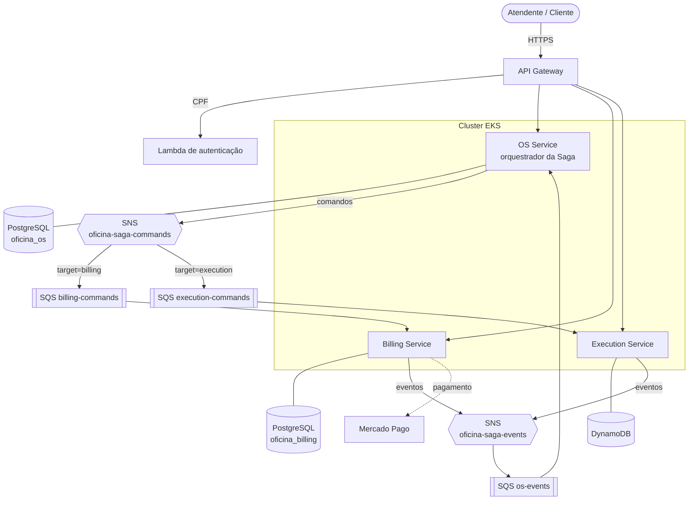
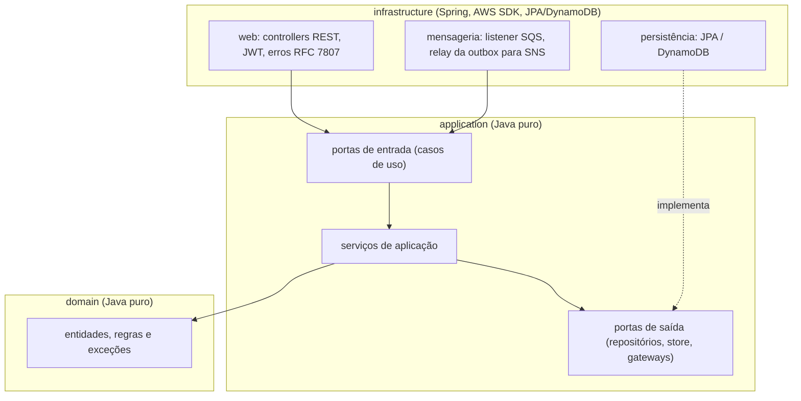
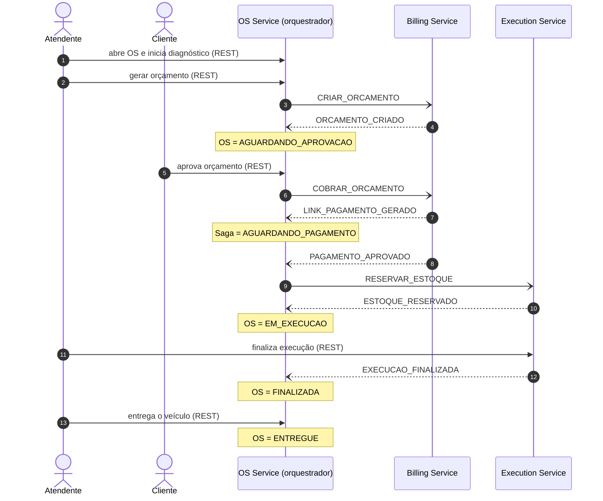
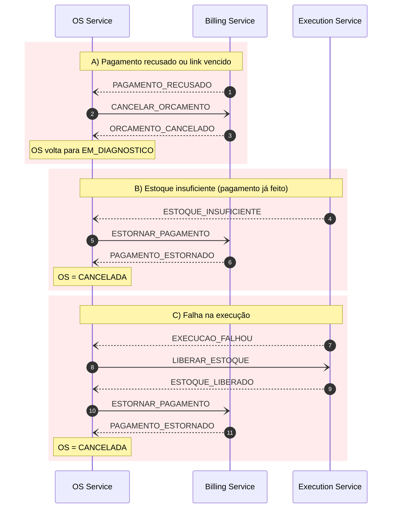
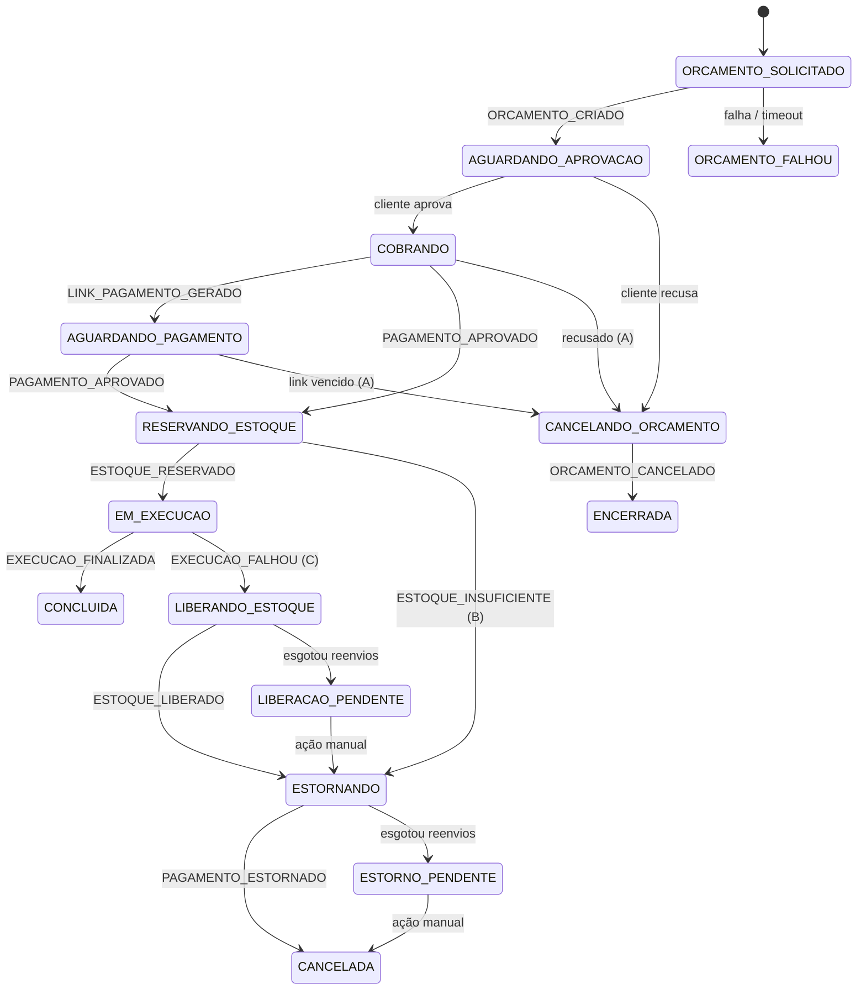
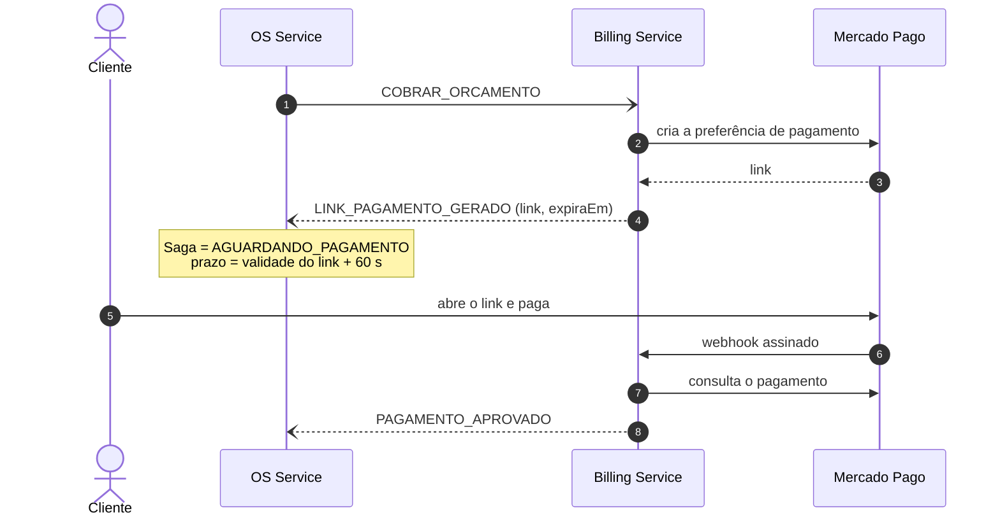
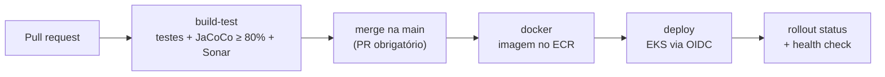

# 1. Identificação

| Campo | Informação |
|---|---|
| Projeto | **Oficina Tech Service**: gestão de oficina mecânica em microsserviços |
| Curso | Pós-graduação em Software Architecture · FIAP · turma 15 (SOAT) |
| Entrega | Tech Challenge Fase 4 |
| Participante | Henrique Dellagnesi Azevedo · RM 372407 · rickd3ll@gmail.com |
| Organização no GitHub | `HDAdeveloper` |
| Usuário avaliador | `soat-architecture`, convidado como colaborador nos 5 repositórios |

# 2. Links dos entregáveis

| Entregável | Link |
|---|---|
| Vídeo de demonstração (≤ 15 min, não listado) | **[PREENCHER: link do vídeo]** |
| Repositório do **OS Service** (PostgreSQL, orquestrador da Saga) | https://github.com/HDAdeveloper/oficina-os-service |
| Repositório do **Billing Service** (PostgreSQL, Mercado Pago) | https://github.com/HDAdeveloper/oficina-billing-service |
| Repositório do **Execution Service** (DynamoDB) | https://github.com/HDAdeveloper/oficina-execution-service |
| Repositório da **Lambda de autenticação por CPF** | https://github.com/HDAdeveloper/oficina-auth-lambda |
| Repositório da **infraestrutura** (Terraform) | https://github.com/HDAdeveloper/oficina-infra |
| Documentação de arquitetura, ADRs, diagramas (workspace) | **[PREENCHER: link do repositório de documentação, se for público]** |

# 3. Resumo executivo

O **Oficina Tech Service** divide o domínio de uma oficina mecânica em **três microsserviços** com banco, repositório, pipeline e implantação próprios: **OS Service** (cadastros, ciclo de vida da ordem de serviço e orquestração), **Billing Service** (orçamento, pagamento e estorno, com Mercado Pago) e **Execution Service** (fila de execução e estoque de peças).

Os serviços conversam por **REST** (usuário para serviço) e por **mensageria assíncrona** (serviço para serviço, com SNS e SQS). Como cada serviço tem o seu banco, não existe transação distribuída; a consistência do fluxo vem de uma **Saga orquestrada**, com compensação em cada etapa que pode falhar.

Pontos que sustentam a solução:

- **Saga orquestrada** no OS Service, com três compensações (pagamento recusado, estoque insuficiente e falha na execução) e estados `*_PENDENTE` para o que exige ação humana.
- **Outbox transacional** e **consumidores idempotentes**: nenhuma mensagem se perde e uma repetição não duplica o efeito, apesar da entrega *at-least-once* do SQS.
- **Poliglotismo justificado**: PostgreSQL onde o domínio é relacional e financeiro; DynamoDB onde o acesso é por chave e a reserva de estoque precisa de escrita condicional.
- **Arquitetura hexagonal** em cada serviço, com domínio e aplicação em Java puro.
- **Pagamento real** por Checkout Pro do Mercado Pago, sem dado de cartão passando pelo sistema, com webhook assinado, consulta antes de decidir, estorno e expiração.
- **Qualidade imposta no build**: cobertura mínima de 80% por serviço (JaCoCo), testes de integração com Testcontainers, BDD (Cucumber) do fluxo da Saga e análise no SonarQube Cloud.
- **Infraestrutura como código** (Terraform) e **CI/CD por serviço** (GitHub Actions) com deploy no EKS via OIDC, sem chave de acesso guardada.
- **Observabilidade** com New Relic: painel, 5 alertas com notificação por e-mail, logs JSON com `correlationId` e `sagaId`.

# 4. Atendimento aos requisitos da Fase 4

| Requisito do enunciado | Como foi atendido | Onde ver |
|---|---|---|
| Pelo menos 3 microsserviços, cada um com repositório, infra e banco próprios | OS, Billing e Execution, em repositórios separados | Seção 2; ADR-001 |
| Um banco SQL e um NoSQL | PostgreSQL (OS e Billing) e DynamoDB (Execution) | Seção 7; ADR-004 |
| Nenhum serviço acessa o banco de outro | Só REST e SNS/SQS entre serviços | ADR-001; `docs/arquitetura.md` |
| Comunicação síncrona e assíncrona | REST nos três serviços; SNS + SQS com DLQ e outbox | Seção 8.7; ADR-003 |
| Saga com compensação, documentada e justificada | Saga orquestrada, três compensações, matriz de falha por etapa | Seção 8; ADR-002; `docs/eventos.md` |
| Integração com o Mercado Pago | Checkout Pro com link, webhook assinado, consulta, expiração e estorno | Seção 8.6; ADR-009; `docs/mercado-pago.md` |
| Testes unitários nos serviços | Domínio e aplicação em JUnit puro; integração com Testcontainers | Seção 10 |
| Pelo menos um fluxo completo com BDD | Cucumber: `saga_ordem_servico.feature` (caminho feliz e compensações) | Seção 10.3 |
| Cobertura mínima de 80% por serviço | Regra do JaCoCo que quebra o build abaixo de 80% de linhas | Seção 10.2 |
| Qualidade no CI | SonarQube Cloud em cada pipeline | Seção 10.4 |
| Pipeline independente por serviço (build, testes, qualidade, deploy em K8s) | GitHub Actions: `build-test`, `docker`, `deploy` | Seção 11 |
| `main` protegida, merge por PR | Ruleset `proteger-main` | Seção 11.3 |
| Dockerfile e manifestos Kubernetes | `Dockerfile` e `k8s/` em cada serviço | Seção 11 |
| Deploy em Kubernetes | EKS na AWS, provisionado por Terraform | Seção 11.2 |
| Swagger ou Postman atualizado | `docs/openapi.json` em cada serviço e coleção Postman do OS Service | Seção 13 |
| Monitoramento e observabilidade | New Relic: painel, alertas, logs estruturados, tracing | Seção 12 |

# 5. Arquitetura

## 5.1 Visão geral

| Serviço | Responsabilidade | Banco | Por que esse banco |
|---|---|---|---|
| OS Service | Clientes, veículos, catálogo de serviços e peças (nome e preço), ciclo de vida da OS, **orquestrador da Saga** | PostgreSQL (RDS) | Domínio relacional, integridade referencial e transações ACID |
| Billing Service | Orçamento, pagamento, estorno, integração com o Mercado Pago | PostgreSQL (RDS, instância separada) | Domínio financeiro, auditável, ACID |
| Execution Service | Fila de execução, estoque (quantidades), reservas | DynamoDB | Acesso por chave e escrita condicional para reservar sem corrida |

**Regra de isolamento:** nenhum serviço lê o banco do outro. O dado de outro serviço chega por mensagem ou por REST.

## 5.2 Estilo interno: arquitetura hexagonal

Cada serviço tem as mesmas camadas, com a dependência sempre apontando para dentro.

- `domain` e `application` não conhecem Spring nem AWS e são testados com JUnit puro, de forma rápida.
- A infraestrutura implementa as portas de saída, por exemplo o `ExecucaoStore` sobre `TransactWriteItems` do DynamoDB.
- Efeito prático: trocar o pagamento simulado pelo Mercado Pago real foi um novo adaptador atrás da porta `PagamentoGateway`, sem mexer nas regras.

## 5.3 Autenticação e acesso

- O cliente entra pelo **API Gateway**, que chama a **Lambda** `oficina-auth-cpf` (`POST /auth/cpf`). A Lambda valida o CPF, consulta o OS Service por REST com um token de serviço e devolve um **JWT** com o papel `CLIENTE`. Ela nunca lê o banco do OS Service (ADR-007).
- A equipe da oficina usa o login do OS Service, que emite o JWT com papel `ADMIN`. Os papéis são `ADMIN`, `CLIENTE` e `SERVICE`.
- O token de `CLIENTE` só abre as rotas do próprio cliente (`/api/minhas-ordens`); a área administrativa responde 403.

**[PREENCHER: diagrama de sequência da autenticação por CPF e abertura de OS, ainda a desenhar]**

# 6. Justificativa da divisão e das tecnologias

## 6.1 Por que três serviços e por que essas fronteiras

A divisão segue fronteiras de **negócio**, não camadas técnicas. Ela nasceu do Event Storming (`docs/event-storming.md`) e da modelagem DDD (`docs/ddd.md`), que identificaram três contextos delimitados com linguagens e ritmos de mudança diferentes:

| Contexto | Linguagem própria | Por que fica separado |
|---|---|---|
| **Ordens de Serviço** | OS, diagnóstico, cliente, veículo, catálogo | É o núcleo do negócio e conhece o estado do fluxo |
| **Faturamento** | Orçamento, pagamento, estorno | Regras financeiras e integração externa mudam por motivos próprios e exigem auditoria |
| **Execução** | Fila, reserva, estoque | Escrita concorrente sobre quantidades, com perfil de acesso diferente |

O catálogo de peças (nome e preço) fica no OS Service, que monta o orçamento. A **quantidade em estoque** é do Execution Service, que é quem reserva e baixa. Assim cada dado tem um único dono (ADR-001, ADR-008).

## 6.2 Decisões registradas (ADRs)

| ADR | Decisão | Motivo em uma linha |
|---|---|---|
| 001 | Três microsserviços: OS, Billing, Execution | Contextos de domínio distintos, bancos separados |
| 002 | Saga **orquestrada**, orquestrador no OS Service | Fluxo de ordem rígida, um ponto conhece o estado, evita um quarto serviço |
| 003 | SNS + SQS, filas standard, DLQ após 3 tentativas | Desacoplamento; idempotência por `messageId` |
| 004 | PostgreSQL (OS, Billing) e DynamoDB (Execution) | Relacional para cadastro e financeiro; chave-valor e escrita condicional para estoque |
| 005 | Ambiente local com docker-compose e LocalStack 4.12 | A versão atual do LocalStack exige conta e token |
| 006 | Execution: `TransactWriteItems` para estado, idempotência e outbox | Tudo ou nada em cada comando |
| 007 | Login por CPF na Lambda; JWT com papéis; consulta por REST | A Lambda não lê o banco do OS Service |
| 008 | Estoque fica no Execution; serviço próprio como evolução | Evita quarto serviço e mudança na Saga |
| 009 | Pagamento por link (Checkout Pro) e Saga que espera o cliente | O cliente paga fora do sistema; nenhum dado de cartão passa por nós |

## 6.3 Tecnologias

| Tecnologia | Uso | Justificativa |
|---|---|---|
| Java 21, Spring Boot 3, Maven | Os três serviços e a Lambda | Ecossistema maduro e domínio em Java puro, testável sem framework |
| PostgreSQL + Flyway | OS e Billing | Esquema só por migração; o Hibernate apenas valida |
| DynamoDB | Execution | Escrita condicional e transações sem servidor de banco |
| SNS + SQS | Mensageria | Gerenciado, filtro por atributo, DLQ e redrive nativos |
| Terraform | Infraestrutura | Reprodutível; permite subir e destruir o ambiente por hora |
| EKS | Orquestração de contêineres | Kubernetes gerenciado, IRSA para permissão mínima por pod |
| GitHub Actions + OIDC | CI/CD | Deploy sem chave de acesso guardada |
| JaCoCo, Testcontainers, Cucumber, SonarQube Cloud | Qualidade | Cobertura imposta, bancos reais nos testes, BDD e análise estática |
| New Relic | Observabilidade | Plano gratuito suficiente, agente Java na imagem |

# 7. Dados e consistência

## 7.1 Modelo de dados

| Serviço | Modelo | Observação |
|---|---|---|
| OS Service | PostgreSQL, migrações Flyway V1 a V4 | Cadastros, OS, itens, histórico, `saga_instance`, `saga_passo`, outbox, mensagens processadas |
| Billing Service | PostgreSQL, migrações Flyway V1 a V3 | Orçamento, pagamento, outbox, mensagens processadas |
| Execution Service | DynamoDB: `estoque` (chave `codigo`), `execucao` (chave `osId`, índice por status e data), mensagens processadas (com TTL) e outbox (índice esparso de pendentes) | Modelado pelos padrões de acesso (ADR-006) |

**[PREENCHER: diagrama ER das migrações do OS e do Billing, ainda a gerar]**

## 7.2 Consistência sem transação distribuída

Não há transação distribuída entre os serviços. A consistência vem de três mecanismos combinados:

1. **Transação local por serviço.** Cada comando é tratado numa transação ACID no próprio banco. No Execution, uma única `TransactWriteItems` grava o estado, a marca de mensagem processada e os eventos a publicar, com a baixa de estoque condicionada a `disponivel >= quantidade`.
2. **Outbox transacional.** O estado e o evento a publicar são gravados juntos; um relay os envia ao SNS depois, com nova tentativa a cada segundo enquanto o SNS falhar. Isso elimina o caso de gravar no banco e perder a mensagem.
3. **Idempotência.** A entrega do SQS standard é *at-least-once*, então todo consumidor guarda o `messageId` já processado e descarta repetições. Os comandos têm também idempotência de negócio: `CRIAR_ORCAMENTO` por OS, `COBRAR_ORCAMENTO` por orçamento, `RESERVAR_ESTOQUE` por OS.

Consequência assumida: o sistema é **eventualmente consistente** entre serviços. Cada serviço é consistente dentro do seu limite e o orquestrador leva o conjunto a um estado final válido: concluído ou compensado.

# 8. Saga: estratégia, justificativa e compensações

## 8.1 Por que orquestração e não coreografia

| Critério | Coreografia | Orquestração (escolhida) |
|---|---|---|
| Onde mora o fluxo | Espalhado nos três serviços | Em um só lugar, o OS Service |
| Compensação em ordem inversa | Difícil de garantir e de explicar | Explícita e testável |
| Auditoria e depuração | É preciso juntar três logs | Diário único da Saga (`saga_instance`, `saga_passo`) |
| Acoplamento | Baixo, mas com dependência implícita entre eventos | Billing e Execution só executam comandos e respondem com eventos |
| Risco | Ciclos e ordem difícil de prever | O orquestrador concentra lógica (aceito; ADR-002) |

O fluxo desta oficina tem ordem rígida e cada passo tem compensação definida. Esse perfil favorece a orquestração. O orquestrador fica dentro do OS Service porque o status da OS já é o estado do fluxo, o que evita um quarto serviço. Se o OS Service cair, a Saga pausa e retoma ao voltar, porque as filas guardam as respostas.

## 8.2 Caminho feliz

## 8.3 Compensações

As compensações rodam na **ordem inversa** dos passos já concluídos: libera o estoque antes de estornar o pagamento. O status extra `CANCELADA` torna a compensação explícita no negócio.

## 8.4 Falha em qualquer etapa

| Passo | Falha | Tratamento |
|---|---|---|
| Criar orçamento | `ORCAMENTO_FALHOU` ou tempo esgotado | Nada a desfazer. A OS fica em `EM_DIAGNOSTICO` e o atendente tenta de novo |
| Cobrar | `PAGAMENTO_RECUSADO` ou link vencido sem pagamento | Compensação A: cancela o orçamento e a OS volta a `EM_DIAGNOSTICO` |
| Reservar estoque | `ESTOQUE_INSUFICIENTE` ou tempo esgotado | Compensação B: estorna o pagamento e a OS fica `CANCELADA` |
| Executar | `EXECUCAO_FALHOU` | Compensação C: libera o estoque, estorna o pagamento e a OS fica `CANCELADA` |
| Estornar (a própria compensação) | Erro ao estornar | Reenvio com tentativas; esgotadas, a mensagem vai à DLQ, gera alerta e a Saga fica em `ESTORNO_PENDENTE` para ação manual |

## 8.5 Estados da Saga

Os estados `*_PENDENTE` indicam que a compensação não terminou sozinha e **exige ação humana**: a mensagem foi para a DLQ e há alerta.

## 8.6 Pagamento por link e a Saga que espera o cliente

O Billing usa o **Checkout Pro** do Mercado Pago (ADR-009). Cada cobrança cria uma preferência e devolve um link; o cliente paga na página do Mercado Pago. Dados de cartão nunca passam pelos nossos serviços.

- **O webhook é só um gatilho.** O Billing consulta o pagamento antes de decidir; avisos repetidos não geram eventos repetidos.
- **Link vencido** vira a compensação A, já existente. O Billing marca o pagamento `EXPIRADO` e publica `PAGAMENTO_RECUSADO`; se ele não avisar, o prazo da Saga dispara a mesma compensação.
- **Pagamento tardio ou duplicado** é devolvido automaticamente pelo provedor, sem mexer na Saga.
- **Webhook com assinatura** validada; endpoint responde 503 se o provedor falhar (o Mercado Pago reenvia) e 200 quando o aviso foi entendido.
- O provedor fica atrás da porta `PagamentoGateway`. O **simulado** é o padrão local, de CI e de testes, e permite provocar cada compensação (`FUND`, `OTHE`, `ERRO`, `ERRO_ESTORNO`).

## 8.7 Entrega, falhas e ordem das mensagens

- **Leitura:** a mensagem só é apagada da fila depois de processada com sucesso. Em erro, volta após o visibility timeout e, na 3ª tentativa, o redrive a envia à `*-dlq`.
- **Tempo limite da Saga:** sem resposta em 60 s o comando é reenviado; esgotadas as tentativas, inicia-se a compensação.
- **Envelope comum:** `messageId`, `sagaId`, `osId`, `type`, `version`, `occurredAt`, `correlationId` e `payload`. O campo `version` permite evoluir o contrato.
- **Ordem:** o relay da outbox preserva a ordem de criação em uma réplica; com várias réplicas lendo ao mesmo tempo (`SKIP LOCKED`) eventos próximos podem se inverter. O orquestrador não depende da ordem entre sagas diferentes e, dentro de uma saga, espera um evento por vez.
- **Mensagem ilegível** (JSON quebrado, `type` desconhecido) vai à DLQ do mesmo jeito.

# 9. Segurança

| Tema | Como é tratado |
|---|---|
| Autenticação | JWT HS256 com papéis `ADMIN`, `CLIENTE` e `SERVICE`; login do cliente por CPF via Lambda |
| Segredo do JWT | Secret do Kubernetes; nunca no Git |
| Credenciais da AWS no CI | OIDC do GitHub assume um papel da AWS; nenhuma chave de acesso guardada |
| Permissão dos pods | IRSA: cada serviço só acessa as suas filas e tabelas |
| Pagamento | Checkout Pro: dados de cartão não passam pelo sistema; webhook assinado e conferido por consulta |
| Erros da API | Formato RFC 7807 (`application/problem+json`) |
| Resposta de login | 401 genérico quando o CPF não existe ou o cliente está inativo, sem revelar qual caso |
| Segredos do Mercado Pago | Apenas em Secrets e variáveis do CI |

# 10. Qualidade

## 10.1 Estratégia de testes

| Nível | Ferramenta | O que cobre |
|---|---|---|
| Unitário | JUnit | Domínio e aplicação em Java puro, sem Spring |
| Integração | Testcontainers (PostgreSQL e LocalStack reais) | Persistência, mensageria, outbox e idempotência, sem mocks de banco |
| Fluxo (BDD) | Cucumber | Saga completa com compensação no OS Service |
| Ponta a ponta local | Scripts PowerShell e Bash | `saga-e2e.ps1` (caminho feliz e compensações A, B, C), `auth-cpf-e2e.ps1`, `billing-e2e.sh`, `execution-e2e.sh` |
| Ponta a ponta na AWS | `saga-e2e.ps1` contra o ambiente implantado | 6 cenários validados em 08/11/2026 |

## 10.2 Cobertura

A regra de **mínimo de 80% das linhas por serviço** está no `pom.xml` (JaCoCo) e **quebra o build** abaixo disso. Ela roda em cada pull request e na `main`.

| Serviço | Linhas | Branches | Testes | Data da medição |
|---|---|---|---|---|
| OS Service | 95,2% | 83,3% | 248 | 15/11/2026 |
| Billing Service | 91,7% | 81,5% | **[ATUALIZAR]** | 15/11/2026 |
| Execution Service | 93,5% | 82,5% | **[ATUALIZAR]** | 15/11/2026 |

Evidências em `docs/evidencias/<serviço>/` e como artefato `evidencias-testes-cobertura` de cada execução do pipeline.

## 10.3 BDD

O arquivo `os-service/src/test/resources/features/saga_ordem_servico.feature` descreve em linguagem de negócio o fluxo completo da OS com a Saga: caminho feliz e as três compensações. Os cenários executam contra o serviço real com PostgreSQL e LocalStack.

## 10.4 Análise estática

SonarQube Cloud em cada pipeline, com *quality gate*. As exclusões de cobertura (por exemplo a classe `main`) ficam explícitas na pipeline e não alteram o relatório do JaCoCo.

# 11. CI/CD e infraestrutura

## 11.1 Pipeline por serviço

- Cada serviço tem o seu `ci.yml`: **build-test** (testes, cobertura, Sonar), **docker** (imagem no ECR `oficina/<serviço>`) e **deploy** no EKS.
- O deploy só roda com a variável `DEPLOY_ENABLED=true`, o que permite manter o ambiente desligado entre as demonstrações, já que a infraestrutura custa por hora.
- Autenticação na AWS por **OIDC**, com um papel criado pelo Terraform; os parâmetros ficam em um secret (`AWS_ROLE_ARN`) e em variáveis (`AWS_REGION`, `EKS_CLUSTER_NAME`).

## 11.2 Infraestrutura como código (Terraform)

O repositório `oficina-infra` provisiona, em dois passos (o segundo informa a URL do OS Service para a Lambda):

| Recurso | Detalhe |
|---|---|
| Rede | VPC e sub-redes |
| EKS | Cluster `oficina-eks`, 2 nós `t3.medium` |
| Bancos | 2 instâncias RDS PostgreSQL e tabelas DynamoDB |
| Mensageria | Tópicos SNS, filas SQS e DLQs, com filtro por `target` |
| Registro de imagens | ECR por serviço |
| Identidade | IRSA por serviço; papel OIDC do GitHub |
| Entrada | API Gateway e Lambda `oficina-auth-cpf` |

O ambiente sobe por hora e é **destruído** depois das demonstrações (custo aproximado de US$ 0,30 a 0,35 por hora). A destruição é conferida por varredura na conta.

## 11.3 Kubernetes e proteção da `main`

- Cada serviço tem `Dockerfile`, `deployment`, `service`, `configmap`, `serviceaccount` e **HPA** (escala de 2 a 5 réplicas por CPU a 70%).
- Sondas de *liveness* e *readiness* em `/actuator/health`.
- A branch `main` de cada repositório tem o ruleset `proteger-main`: merge só por pull request, com as checagens do pipeline.

# 12. Observabilidade

| Recurso | Implementação |
|---|---|
| Agente | New Relic Java na imagem, ligado quando existe o segredo `newrelic` no cluster |
| Logs | JSON estruturado (formato ECS) com `correlationId` e `sagaId`, encaminhados ao New Relic |
| Rastreio da Saga | Eventos customizados `SagaPasso` e `SagaTransicao`, usados no painel |
| Painel | 3 páginas: operação, Saga e observabilidade (latência, erros, vazão por serviço, volume de OS, tempo por status, erros de integração) |
| Alertas | 5 condições na política "Oficina", com notificação por e-mail |
| Saúde | `/actuator/health` com liveness e readiness |

Os 5 alertas: falha no processamento de OS (Saga), erros HTTP acima de 5%, latência p95 acima de 2 s, serviço sem sinal e respostas da Saga atrasadas.

O `correlationId` nasce no cabeçalho `X-Correlation-Id` da requisição, atravessa o envelope das mensagens e aparece nos logs dos três serviços, o que permite seguir uma operação de ponta a ponta.

# 13. Contrato da API

- Cada serviço publica o Swagger pelo springdoc (`/swagger-ui.html`) e versiona o contrato em `docs/openapi.json`.
- O OS Service tem também a coleção Postman em `docs/postman/`.
- A Lambda de autenticação documenta o `POST /auth/cpf` (entrada, saída, erros) no README.
- O OS Service inclui o **Monitor da Saga** (`/saga-monitor.html`), página de demonstração que mostra a máquina de estados e as mensagens entre os serviços em tempo real.

# 14. Trade-offs, limitações e evolução

## 14.1 Trade-offs assumidos

| Decisão | Ganho | Custo aceito |
|---|---|---|
| Orquestração central | Fluxo legível, auditável, compensação em ordem | O OS Service concentra a lógica da Saga |
| Outbox e entrega *at-least-once* | Nenhuma mensagem perdida | Consumidores precisam ser idempotentes |
| DynamoDB no Execution | Escrita condicional e transações, escala simples | Consultas só pelos índices modelados |
| Segredo JWT compartilhado | Simplicidade para o prazo | Rotação manual |
| Filas standard (não FIFO) | Vazão e custo | Ordem não garantida entre sagas |
| Pagamento por link | Sem dado de cartão e sem frontend | O webhook precisa de URL pública |

## 14.2 Limitações conhecidas (declaradas de forma honesta)

- O webhook do Mercado Pago exige **URL pública HTTPS**. Localmente funciona com túnel; na AWS o Billing não é exposto e a rota pública só do webhook não foi incluída (ADR-009).
- Enquanto o link de pagamento está aberto, o cliente não consegue recusar o orçamento; cancelar o link é evolução futura.
- Compensações com `*_PENDENTE` dependem de ação humana por desenho.

## 14.3 Evolução

- Trocar o JWT HS256 por **chave assimétrica** (RS256) com JWKS, eliminando o segredo compartilhado.
- Extrair o **estoque** para um quarto serviço (ADR-008), sem mudar a Saga.
- Rota pública para o webhook do Mercado Pago pelo API Gateway.
- Cancelamento do link de pagamento.
- Evoluir de SQS para um barramento com ordenação por chave, se a ordem entre eventos passar a importar.

# 15. Índice de evidências

| Evidência | Local |
|---|---|
| Contrato de mensagens e compensações | `docs/eventos.md` |
| ADRs 001 a 009 | `docs/adr/` |
| Modelagem DDD e mapa de contextos | `docs/ddd.md`, `docs/diagramas/ddd/` |
| Event Storming | `docs/event-storming.md`, `docs/diagramas/event-storming/` |
| Mercado Pago (link, webhook, estorno) | `docs/mercado-pago.md`, `docs/evidencias/mercado-pago/` |
| Cobertura por serviço | `docs/cobertura.md`, `docs/evidencias/<serviço>/` |
| Painel do New Relic | `docs/observabilidade/dashboard-newrelic.json` |
| Roteiro do vídeo e guia de gravação | `docs/roteiro-narracao.md`, `docs/guia-gravacao.md` |
| Checklist de entrega | `docs/checklist-entrega.md` |

# 16. Vídeo: o que cada trecho demonstra

| Trecho | Requisito demonstrado |
|---|---|
| Slides: problema, arquitetura, Saga | Divisão em microsserviços, estratégia e justificativa da Saga |
| Clipe A: Monitor da Saga | Fluxo completo de uma OS e as compensações A, B e C |
| Clipe B: testes e cobertura | Testes, cobertura ≥ 80%, Sonar e BDD |
| Clipe C: pipeline | Deploy automatizado com validação de testes |
| Clipe D: AWS e New Relic | Kubernetes, monitoramento e alertas |
